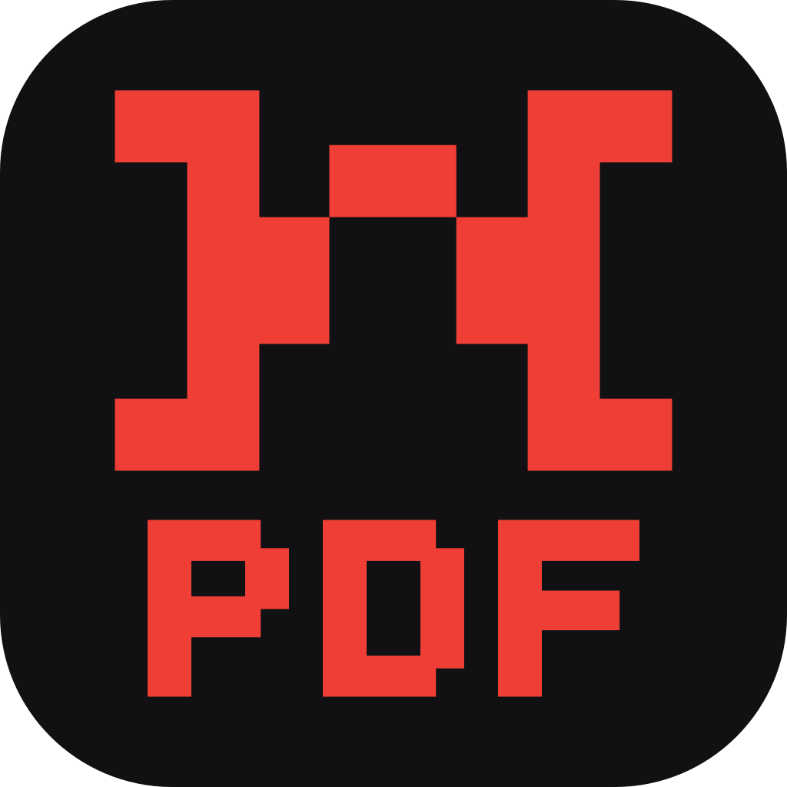

<p align="center">
  
</p>

<h1 align="center">NadsPDF</h1>

<p align="center">
  <b>Le lecteur et éditeur PDF de nads.</b><br>
  Natif, rapide, 100 % local : aucun compte, aucune télémétrie, aucun logiciel externe.
</p>

---

NadsPDF est un fork de [PdfCraft](https://github.com/storytold/pdfcraft) (lecteur/éditeur PDF
open source écrit en Rust, licence MIT OR Apache-2.0), habillé au style de nads.site — socle
presque noir, panneaux flottants arrondis, police Onest, accent rouge — et enrichi des fonctions
de l'ancienne application NadsPDF (Electron, conservée dans [`legacy-electron/`](legacy-electron/)).

## ✨ Ce qu'il fait

**Lire** — rendu fidèle, recherche, sélection et copie de texte, signets, miniatures, calques,
pièces jointes, mode lecture et plein écran, onglets multiples, pages sombres (Ctrl+Maj+D).

**Ranger** — *groupes d'onglets* à la Chrome : clic droit sur un onglet ▸ « Ajouter l'onglet à
un nouveau groupe » (ou Ctrl+Maj+K), un nom, une couleur ; un clic sur la pastille replie le
groupe. Rien n'est groupé automatiquement ; avec « Rouvrir les fichiers de la dernière session »
(Préférences), les groupes reviennent au lancement suivant.
*Bulles* : clic droit sur un onglet ▸ « Mettre en bulle » pour superposer un PDF aux autres dans
une petite fenêtre. Un clic ailleurs la réduit en rond, que l'on glisse n'importe où ; un clic
dessus la rouvre ; glissée sur la barre d'onglets, elle redevient un onglet.
*Coffres* sur l'accueil : des collections nommées, colorées et iconées de PDF dispersés sur
l'ordinateur.

**Outils NadsPDF** (écran d'accueil, un clic chacun) :

| Outil | Ce qu'il fait |
|-------|---------------|
| **Convertir en PDF** | Word (.docx), Excel (.xlsx/.ods), CSV, texte, HTML et images → PDF, en Rust pur |
| **Compresser** | Réduire la taille (rééchantillonnage des images, nettoyage) ; « Rastériser les pages (compression forte) » transforme chaque page en JPEG |
| **Fusionner** | Combiner plusieurs PDF, dans l'ordre choisi |
| **Diviser & organiser** | Extraire, supprimer, réordonner, pivoter des pages |
| **Éditer le texte** | Modifier les mots d'un PDF existant, images, objets |
| **PDF → images** | Exporter les pages en PNG ou JPEG |
| **Images → PDF** | Assembler PNG/JPEG en un seul PDF |
| **Filigrane** | « CONFIDENTIEL » ou tout autre texte sur chaque page |
| **Numéros de page** | En-tête / pied de page « 1 / 10 » |
| **Pipelines** | Enchaîner des étapes sur plusieurs fichiers (Action Wizard) |

Et tout PdfCraft en plus : commentaires et annotations, formulaires (remplir et créer),
signatures, protection par mot de passe, caviardage, OCR, comparaison de documents, filigranes,
en-têtes/pieds de page, numérotation Bates, export Word/HTML/RTF, accessibilité, impression…

**Exporter en Word** garde la mise en page : une page avec des fonds, des formes ou des images
devient l'image de la page sans son texte, avec par-dessus le texte modifiable, ligne par ligne, dans
les polices, tailles et couleurs du PDF. Les pages de texte simple restent en paragraphes fluides.

## 🧩 Extension Chrome

Comme Acrobat : les PDF ouverts dans Chrome s'affichent dans NadsPDF (la version WebAssembly,
embarquée dans l'extension ; rien n'est envoyé sur Internet).

```powershell
powershell -File packaging\chrome\build.ps1     # → dist\chrome-extension\ et un .zip
```

Elle marche dans tous les navigateurs Chromium : Chrome, Comet, Edge, Brave… Ouvrir la page des
extensions (`chrome://extensions`, `comet://extensions` dans Comet, `edge://extensions` dans Edge)
▸ *Mode développeur* ▸ *Charger l'extension non empaquetée* ▸ `dist\chrome-extension`. Pour les PDF de l'ordinateur, activer *Autoriser l'accès aux URL de
fichier* dans les détails de l'extension.

## 🚀 Lancer

Prérequis : [Rust](https://rustup.rs) 1.95 ou plus récent.

```sh
cargo run --release -p pdfcraft -- mon-fichier.pdf     # l'application (binaire « nadspdf »)
cargo run -p pdfcraft-cli -- tools                      # les outils en ligne de commande
```

Le binaire compilé se trouve dans `target/release/nadspdf.exe`. L'installateur Windows (.msi, en
français, avec raccourcis, menu clic droit et choix du lecteur PDF par défaut à la fin) :
`powershell -File packaging\windows\package.ps1` → `dist\release\`.

## 📦 Publier une version

```powershell
powershell -ExecutionPolicy Bypass -File packaging\release.ps1 0.7.2
```

Le script change le numéro de version, construit le `.msi`, la version portable, l'extension et
le paquet Microsoft Store, puis crée la release sur GitHub. Les copies installées avec le `.msi`
la voient au démarrage suivant (une vérification par jour, désactivable) et proposent
« Mettre à jour » : NadsPDF télécharge le `.msi`, vérifie son empreinte SHA-256, se ferme,
remplace l'ancienne version (réglages conservés) et se rouvre. La version du Microsoft Store est
mise à jour par le Store ([`packaging/windows/msix/PUBLIER-STORE.md`](packaging/windows/msix/PUBLIER-STORE.md)).
Confidentialité : [PRIVACY.md](PRIVACY.md).

## 🎨 Identité

- Logo : le « N » de nads.site en rouge (`#EF3E36`) avec « PDF » en lettres géométriques
  dessous, sur une tuile `#111113`. Toutes les icônes (`.ico`, `.icns`, PNG) sont générées par
  `python packaging/nads_icons.py` (Pillow).
- Thème : jetons de couleur dans [`crates/ui-egui/src/theme.rs`](crates/ui-egui/src/theme.rs)
  (sombre par défaut, clair disponible), police Onest (OFL-1.1).

## 🏗️ Architecture

Un workspace Cargo de crates spécialisées (voir [`docs/README-pdfcraft.md`](docs/README-pdfcraft.md)
pour le détail amont) : `cos` (objets PDF), `render`, `organize`, `edit`, `annot`, `forms`,
`optimize`, `create`, `convert` (Office/HTML/CSV → PDF, ajouté par NadsPDF), `engine` (façade),
`ui-egui` (interface), `automation` (outils sans interface et serveur MCP opt-in).

## 📄 Licence et crédits

Code : MIT OR Apache-2.0, comme PdfCraft — Copyright (c) 2026 ArtCraft Team et les contributeurs
PdfCraft ; modifications NadsPDF par nads. Notices dans [NOTICE](NOTICE), ressources tierces dans
[ATTRIBUTION.md](ATTRIBUTION.md).

Le logo nads / NadsPDF et les icônes de l'application sont des marques de nads et ne sont pas
couverts par la licence du code ([`docs/brand/LICENSE-brand.txt`](docs/brand/LICENSE-brand.txt)).

NadsPDF n'est affilié ni à ArtCraft ni à Adobe.
