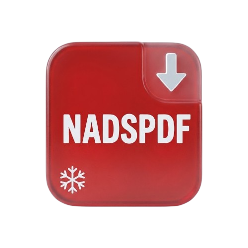

# NADSPDF ❄️

Boîte à outils PDF de bureau, **100 % autonome** — aucune installation de
LibreOffice ni de Ghostscript n'est requise. Design façon Apple : verre dépoli,
dégradés granuleux animés et reflet qui suit la souris.



---

## ✨ Fonctionnalités

| Outil | Ce qu'il fait | Comment ça marche (sans logiciel externe) |
|-------|---------------|-------------------------------------------|
| **Convertir** | Word, Excel, CSV, texte, HTML → PDF | `mammoth`/`xlsx` produisent du HTML, rendu en PDF par le moteur intégré d'Electron (`printToPDF`) |
| **Compresser** | 3 niveaux : Léger / Moyen / Fort | Chaque page est rasterisée puis ré-encodée en JPEG (via `pdf.js` + `pdf-lib`) |
| **Fusionner** | Plusieurs PDF → un seul (ordre réglable) | `pdf-lib` |
| **Diviser** | Extraire des pages (clic sur l'aperçu) | `pdf-lib` |
| **Pivoter** | Rotation 90° / 180° / 270° | `pdf-lib` |
| **PDF → Images** | Chaque page en PNG (1× / 2× / 3×) | `pdf.js` |
| **Images → PDF** | PNG / JPG → un seul PDF | `pdf-lib` |

> ⚠️ Les formats `.doc`, `.ppt`, `.pptx`, `.odt`, `.odp` (anciens binaires
> Office) ne sont **pas** convertibles sans LibreOffice. Utilisez `.docx` /
> `.xlsx`. La compression transforme le texte vectoriel en image : idéale pour
> les scans, à éviter si vous devez garder le texte sélectionnable.

---

## 🚀 Démarrer (développement)

```bash
npm install      # une seule fois
npm run dev      # lance Vite + la fenêtre Electron
```

La fenêtre s'ouvre automatiquement. Toute modification du code se recharge à chaud.

## 📦 Construire l'exécutable Windows

```bash
npm run build    # vérifie les types + compile (dossiers dist/ et dist-electron/)
npm run dist      # génère l'installateur .exe + la version portable dans release/
```

Résultat dans `release/` :
- `NADSPDF Setup x.y.z.exe` — installateur (choix du dossier d'installation)
- `NADSPDF x.y.z.exe` — version portable, aucune installation

## 🧭 Utiliser l'application

1. Choisissez un outil dans la barre latérale gauche.
2. **Glissez-déposez** vos fichiers sur la grande zone (ou cliquez pour parcourir).
3. Réglez les options (niveau de compression, pages à extraire, angle…).
   - Pour **Diviser**, cliquez directement les pages dans l'aperçu.
   - Pour **Pivoter**, l'aperçu montre la rotation en temps réel.
4. Cliquez le bouton d'action ; choisissez où enregistrer.
5. Cliquez **Ouvrir** pour révéler le résultat dans l'explorateur.

---

## 🏗️ Architecture

```
nadspdf/
├── electron/
│   ├── main.ts            # fenêtre, dialogues, contrôles
│   ├── preload.ts         # pont IPC sécurisé (window.pdf.*)
│   └── handlers/index.ts  # merge/split/rotate/convert/imagesToPdf
├── src/
│   ├── components/        # TitleBar, Sidebar, DropZone, FileList,
│   │                      # Workspace, PdfPreview, GrainGradient,
│   │                      # CursorGlow, GlassCard, LoadingScreen
│   ├── lib/               # pdfRender, pdfCompress, pdfThumbs, ranges,
│   │                      # tools, fileVisual, utils
│   ├── store/useStore.ts  # état global (Zustand)
│   └── index.css          # design system (verre, grain, reflet)
└── assets/logo.png        # logo + icône de l'app
```

**Stack** : Electron · React 18 · TypeScript · Vite · Tailwind CSS ·
Framer Motion · pdf-lib · pdf.js · mammoth · SheetJS.
